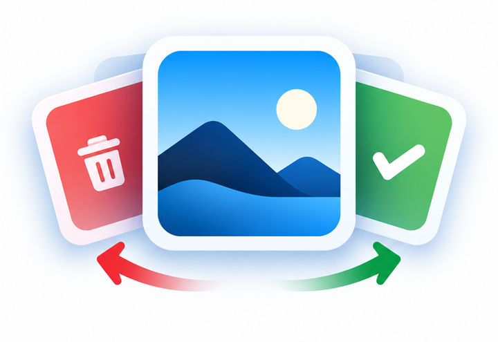
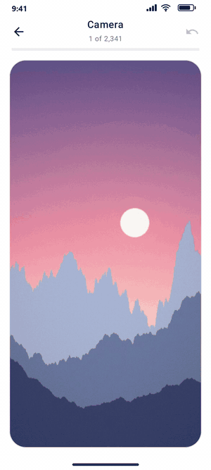
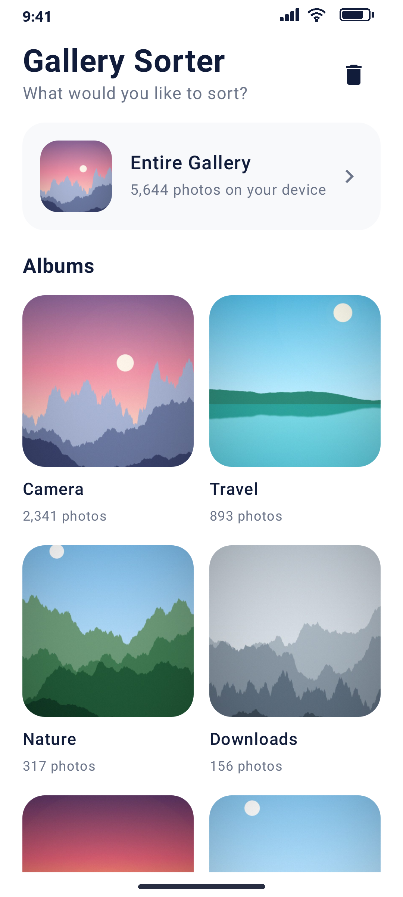
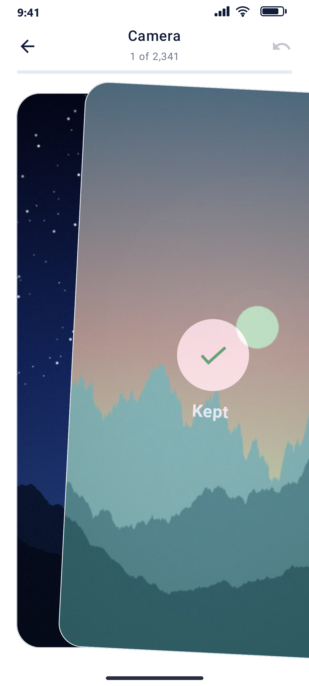
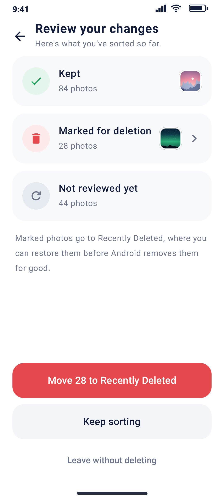
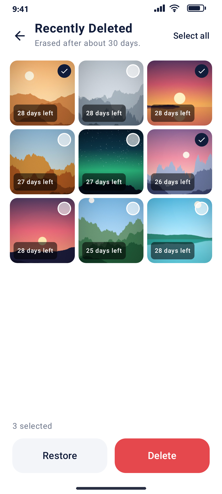

<p align="center">
  
</p>

<h1 align="center">Gallery Sorter</h1>

<p align="center">Swipe right to keep. Swipe left to delete.<br>Clean up your Android gallery in minutes, fully offline.</p>

<p align="center">
  <a href="https://github.com/milesARG/gallery-sorter/releases/latest/download/GallerySorter.apk"><b>Download APK</b></a>
</p>

<p align="center">
  
</p>

<p align="center">
  
  
  
  
</p>

## How it works

1. Choose your entire gallery or one album.
2. Swipe right to keep a photo, left to mark it. Undo reverses the last swipe.
3. Review the summary, then move the marked photos to Android's Recently Deleted.
4. Restore or permanently delete them from Recently Deleted.

Swiping never deletes anything. Photos are only trashed after you confirm, through Android's own system dialog.

## Privacy

No internet permission, accounts, ads or analytics. Photos are read in place through MediaStore and are never uploaded or copied.

## Requirements

Android 11 (API 30) or newer. Photos only; videos are not included.

## Install

Download the APK on your phone, allow installs from unknown sources, and open it. The release is debug-signed and not on the Play Store, so Play Protect may ask for confirmation.

## Build

Requires JDK 17 and the Android SDK (API 34).

```bash
./gradlew testDebugUnitTest assembleDebug
```

The APK is written to `app/build/outputs/apk/debug/app-debug.apk`.

## Screenshots

The images in `screenshots/` are rendered from the real app code (activity, view model and MediaStore queries) on the JVM with Robolectric, using a fake gallery of generated landscapes. They are not captured from a phone. To regenerate the raw renders:

```bash
./gradlew :app:testDebugUnitTest -Pscreenshots --tests "*ScreenshotTest*"
```

Kotlin · Jetpack Compose · Material 3 · Coil · MediaStore